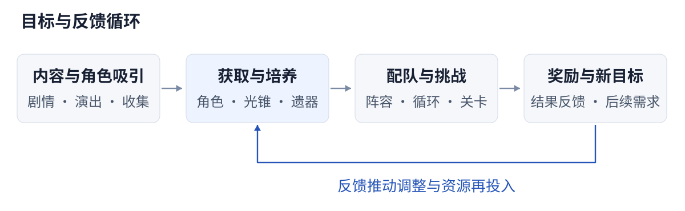
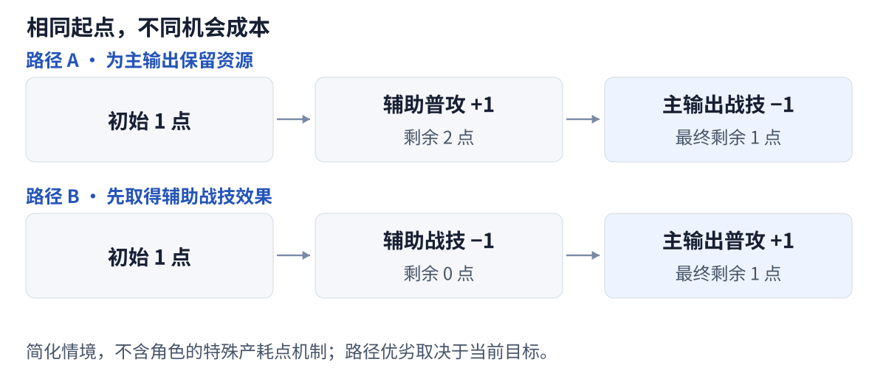
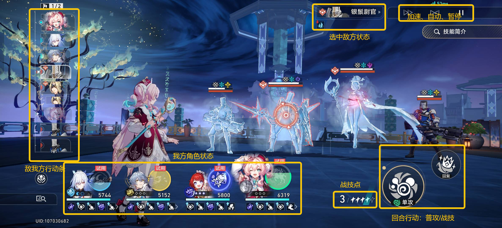
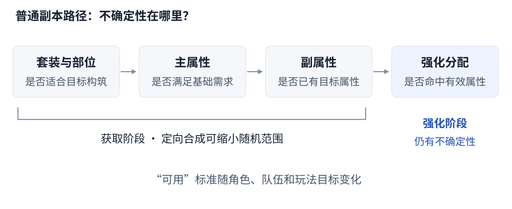

# 《崩坏：星穹铁道》系统拆解

## 低操作负担下，策略与养成如何形成长期目标？

分析范围：首次撰写于 2025 年 9 月 20 日，主要参考 3.5 版本。基于开服以来的个人游玩体验，聚焦战斗、养成及其相互作用。初稿完成于[飞书](https://my.feishu.cn/wiki/Q4gawk60ait1SQkkoKicph6InOQ?from=from_copylink)，后续使用AI工具部署网页，持续迭代更新中。

**核心判断**

- **低操作门槛仍能容纳策略取舍。** 配队与装备决定可用手段，战技点、行动顺序和终结技时机决定手段如何兑现。
- **养成提供了两种不同的目标。** 等级与行迹带来可预期的成长，遗器随机性延续长期追求，也增加了投入无法转化为有效提升的风险。
- **新目标的成本包含整支队伍的重新磨合。** 当角色、装备与关卡需求接连变化，玩家的投入会延伸到队友配置、资源供需与行动顺序的调整。

## 01 · 全局：内容吸引、养成与挑战相互连接

### 1.1 体验构成：角色内容提供动机，战斗与养成承接投入

《崩铁》将角色收集、剧情探索与回合制战斗结合在一起。玩家接触角色的过程发生在剧情、演出和探索中，而使用角色的过程主要发生在配队、培养和关卡挑战中。前者回答“为什么想获得这个角色”，后者回答“获得以后可以做什么”。

这使角色同时承载情感价值与战斗价值。喜欢角色的玩家未必追求高难成绩，但仍需要基础养成来体验角色的完整内容；重视强度的玩家则会把技能、装备和队伍联动作为获取决策的依据。

### 1.2 核心循环：从获得角色，到检验整支队伍

剧情和演出建立角色吸引力，养成将角色转化为可用的战斗能力，关卡为阵容配置与资源投入提供检验场景。挑战结果再影响下一轮选择：补足生存、调整循环、培养替代角色，或者继续提升已有装备。

| 系统环节 | 玩家关注的问题 | 与下一环节的联系 |
| --- | --- | --- |
| 内容与角色吸引 | 我为什么想接触或获得这个角色？ | 将内容兴趣转化为收集与使用目标 |
| 获取与培养 | 需要准备哪些角色、装备和资源？ | 把拥有角色转化为能够使用角色 |
| 配队与挑战 | 这支队伍能否解决当前问题？ | 让能力提升获得具体的检验场景 |
| 结果与新目标 | 哪些投入有效，下一步还缺什么？ | 引导继续培养、改变配置或调整目标 |

这不是每名玩家必须依次完成的固定流程，不同玩家群体存在不同的游玩行为：剧情玩家可以减少挑战投入；高难玩家则可能反复返回培养和构筑环节。循环能否成立，取决于玩家能否从结果中辨认出下一步目标，而不只是不断接到新的消耗要求。

### 1.3 时间结构：内容体验、日常积累与阶段挑战

剧情、探索和活动提供阶段性的新鲜内容；日常资源获取承担持续积累；关卡挑战则让已有积累得到检验。三者的体验节奏不同，适合承担不同的任务。

日常耗时与长期养成压力对应两种不同的成本。自动完成资源关卡减少了单次登录中重复操作所占的时间；角色培养的完成周期，则受体力恢复、材料需求和遗器获取结果影响。玩家每天操作较少，但仍可能经历较长的培养周期。新内容带来的角色和装备需求，还会让多个养成目标争夺同一批资源。操作上的轻量化与长期目标的积累压力，由此并存。

### 1.4 评价：不同目标能否共享同一套系统

系统的优势在于，同一套角色内容可以同时服务剧情体验、情感收集、基础通关和高难挑战。不同玩家可以采用不同的投入强度，不必对所有系统投入相同精力。

它的张力也来自这种共享：当高难目标被视为日常资源获取的一部分时，玩家可能把原本可选的深度培养理解为必须完成的任务。玩家原本以完成剧情为目标，却可能因为尚未取得的挑战奖励，继续承担更高的培养成本。内容增加了可选目标，奖励关联又提高了放弃这些目标的心理成本。

**要点：** 同一套长期循环承载了不同深度的投入：角色内容建立兴趣，养成与挑战把兴趣转化为使用体验。当获取角色后的准备周期过长，或使用门槛超出玩家原有目标，最初的兴趣就可能被后续积累压力消耗。

## 02 · 战斗：个人最优动作未必是团队最优选择

### 2.1 战前构筑：选择角色，也选择资源循环

玩家先根据敌人的弱点、机制和关卡目标选择队伍，再配置装备与行动顺序。输出、增益和生存构成队伍的基本职能，资源供需与触发条件则决定这些职能能否在战斗中持续发挥作用。

同样是提供增益的角色，启动条件、维持方式和战技点需求可能不同。效果适配决定角色之间能产生哪些联动，资源供给决定这些联动能持续多久。战前构筑由角色能力、效果配合与资源循环共同组成。

命途提供了角色分类和光锥选择的入口；具体的产点、耗点、行动和触发条件倾向，则决定角色在队伍中的实际作用。同一职能的角色，也可能因资源循环不同，适配不同的队友。

### 2.2 战技点：用共享资源连接个人与团队

| 决策对象 | 玩家需要权衡什么 | 设计作用 |
| --- | --- | --- |
| 战技点 | 当前角色使用战技，是否会挤占后续角色的资源？ | 将单个角色的动作连接为团队资源分配 |
| 行动顺序 | 增益、治疗与输出在什么时候发生？ | 让速度和行动提前产生超出面板数值的价值 |
| 终结技 | 立即释放，还是等待增益、削韧或生存需求？ | 在常规行动之外增加时机选择 |
| 弱点击破 | 优先击破哪名敌人，是否值得调整攻击目标？ | 将属性、敌人机制与行动控制联系起来 |

**一个战技点分配情境**

假设当前只有 1 点战技点，辅助先于主输出行动；普攻回复 1 点，战技消耗 1 点，不考虑额外产点、耗点或插入行动。

两条路径最终都剩 1 点，但效果不同：前者保留了主输出使用战技的机会，后者先取得辅助战技的效果。若当前必须治疗或补增益，后者可能更合理。同样的战技点结余，可以对应不同的输出、生存和增益结果；两条路径的价值差异，来自它们优先兑现了哪一种收益。

共享资源使单个角色的动作收益与全队收益产生差异。一次治疗可能牺牲输出机会，却避免减员；一次普攻可能放弃当前增益，却为后续爆发留出资源。少量操作选项因此可以形成明确的机会成本。

### 2.3 行动顺序：更快不一定等于整队更强

速度和行动提前影响角色何时获得行动机会，其价值不仅是增加行动次数，也包括改变增益、产点、耗点和伤害发生的先后关系。

例如，辅助先行动可以为输出准备增益效果，也可能提前消耗队伍仅有的战技点；输出增加行动机会，如果同时增加耗点需求，就需要其他队友补足供给。只提高一名角色的速度，未必能直接改善整段循环。

配速的实际价值体现在行动次数与关键动作的先后关系中：增益是否覆盖输出、资源是否在消耗前到位、治疗或控制是否赶在敌人行动前生效。速度提升带来的额外行动能否兑现收益，取决于资源和效果覆盖能否跟上；偏离原有配合顺序，也可能产生额外耗点或增益错位。

### 2.4 终结技与击破：把握常规行动之外的窗口

终结技的插入释放，使能量就绪与实际释放时机成为两个问题。在规则允许的窗口中，玩家可以选择立即兑现收益，也可以等待队友增益、敌人状态变化或生存需求。

这使玩家在角色的常规回合之外仍有观察和决策的空间。立即释放可以兑现当前收益，并为后续获得的能量留出空间；延后释放可能换取更完整的增益覆盖，或保留应对危险的手段。等待期间错过攻击窗口、无法充分利用后续能量，则构成延后释放的成本。

弱点击破的收益由伤害、行动控制和关卡额外效果共同组成。以 3.5 的“末日幻影·天狼战首”为例，击破带来的效果包含恢复战技点和激活终结技，击破时机因而同时影响资源与输出安排。在这样的规则下，削韧也成为开启下一段资源循环的手段，其价值随关卡机制发生变化。

### 2.5 信息呈现：让取舍有依据，让失败能解释

行动序列、敌人弱点、角色状态和可查询的规则，为玩家提供判断依据。信息相对透明，可以减少反复试错才能理解机制的负担，也让玩家更容易把失败归因到具体问题：缺少资源、行动错位、增益中断，还是没有处理敌人的关键机制。

信息查询降低了获取规则的成本，信息层级则影响从规则中找到行动依据的成本。当角色状态和触发条件增多，玩家会同时面对多条有效信息；战技点、行动顺序与关键状态的呈现位置和显著程度，影响他们能否快速识别下一次动作的限制与机会。

### 2.6 评价：低门槛能否持续保留有效决策

基础操作保持简洁，便于玩家在熟悉规则后快速进入战斗；构筑与共享资源，则把深度放在动作之间的关联上。这种形式适合将一部分思考前置到配队阶段，让重复关卡的执行负担相对可控。

当养成优势足以跳过敌人机制，或关卡只剩固定操作顺序时，局内取舍可能逐渐失去意义。有效策略空间来自可行选择之间的收益差异：输出、资源和生存发生冲突时，玩家的选择会改变战斗结果；机制数量增加却没有改变最优行动时，增加的更多是理解规则的负担。

**要点：** 战斗深度来自资源、行动与关卡目标之间的相互约束。同一个动作在不同的资源余量和敌人状态下，可能产生不同的团队收益；当前收益与后续机会之间的取舍，使简洁的操作形成策略空间。

## 03 · 养成：从可预期成长，到不确定的提升

### 3.1 进度分层：先建立阶段目标，再开放更多选择

开拓等级、均衡等级与角色成长上限，将账号养成拆分为多个阶段。玩家在不同阶段面对的目标和资源效率有所变化，不必从开始就同时处理全部培养内容。

阶段门槛能够组织体验顺序，让等级、技能和装备逐步进入决策范围。但门槛也会形成等待：当玩家已理解下一步目标，却暂时无法获得所需资源或解锁能力时，继续游玩的动机可能减弱。

这套进度控制通过等级门槛组织成长顺序，通过资源效率变化调整积累节奏。处于同一阶段的玩家，仍会因已有阵容和实际投入不同而面对不同的挑战压力；阶段框架相同，具体的通关体验则存在差异。

### 3.2 确定性成长：数值提升与机制解锁承担不同作用

| 养成部分 | 主要获得什么 | 决策重点 |
| --- | --- | --- |
| 等级与晋阶 | 基础属性成长及后续成长空间 | 哪些角色先达到目标玩法的基础要求 |
| 行迹 | 技能提升、额外能力与属性补充 | 先解锁关键能力，还是继续提高技能数值 |
| 光锥 | 基础属性与构筑相关效果 | 命途适配、队伍需求与替代选择 |
| 星魂 | 数值或机制上的进一步提升 | 追加获取成本与目标收益是否匹配 |
| 遗器 | 套装效果、属性组合与强化成长 | 先达到可用标准，再继续追求更优配置 |

等级与多数材料型成长具有较明确的目标。行迹还可以进一步区分为技能数值、机制解锁和固定属性补充：前者提高已有能力的效果，后两者可能影响玩法成立的条件或装备需求。

不同成长项目的收益在队伍成形过程中并不均匀。解锁关键能力，可能让原本无法持续的技能循环开始运转；在循环已成立后继续提高数值，则更多表现为效率和余量的增加。机制成形与数值完善，由此形成不同的投入优先级和反馈节点。

### 3.3 光锥与星魂：额外投入怎样影响构筑

光锥把装备效果与角色手持物表现分离：装备选择可以影响构筑，而不必改变角色武器和动作的视觉设定。它扩大了表现设计的自由度，装备差异的辨识则更多依赖图像、文本与实际效果。

光锥对队伍的影响既包括伤害，也包括能量、资源与效果触发条件。某些替代选择的单次伤害较低，却可能通过补足循环缺口，让关键技能更稳定地发挥作用。角色、队友与关卡目标改变时，同一光锥的实际收益也会变化。

星魂同样可能同时承担数值提升与机制变化。数值提升强化已有动作的效果；配队限制、资源供需或触发条件的变化，则可能改变角色可采用的队伍与操作方式。当额外投入解决的是玩法成立的条件，基础体验与追加获取之间的关联会更紧密。其收益随原有队伍的瓶颈而变化：缺少的能力被补足时，体验变化可能比单次伤害增长更明显。

### 3.4 遗器随机性：获得装备与获得有效提升是两回事

普通副本获取的遗器，需要经过套装与部位、主属性、副属性以及强化分配等环节的筛选。前一环节满足需求，不代表后续环节也会满足需求；持续获得装备，也不意味着当前角色持续获得提升。

获取与强化的反馈因此不同。拿到合适胚子意味着获得了尝试机会，强化形成有效成长才意味着这次尝试接近目标。玩家已经在获取阶段投入资源时，后续结果不理想可能使先前的期待落空。

这种随机性保留了长期追求和属性组合的差异，也使目标完成时间变得不确定。它与等级、行迹的关键区别，并非单次消耗高低，而是追加同等投入后，玩家能否预期自己会更接近目标。

### 3.5 可控工具：缩小不确定性，但作用环节不同

**3.5 版本的可控工具：** 自塑尘脂可用于定向合成的主副属性；变量骰子提供对满级遗器副属性强化分配的重掷机会。3.5 已将遂愿尘脂合并至自塑尘脂。[版本规则说明](https://weibo.com/ttarticle/p/show?id=2309405199075288416343)

| 工具作用 | 解决的问题 | 仍然存在的边界 |
| --- | --- | --- |
| 定向合成 | 缩小获取目标胚子时的随机范围 | 强化阶段仍保留随机分配 |
| 强化分配重掷 | 为已有胚子提供重新尝试的机会 | 重掷结果仍具有随机性 |

两类工具对应不同的培养瓶颈。对缺少合适主属性的玩家，获取阶段的确定性更接近当前需求；对已有合适胚子却强化不理想的玩家，重新分配的机会更切中问题。

工具的作用范围与可获得次数，共同影响它对养成压力的缓解程度。一次使用可以缩小某个环节的不确定性，但多名角色、多个部位的培养会形成重复需求。工具对单次尝试有帮助，与玩家能否在预期时间内完成整套配装，是两个不同层次的结果。

### 3.6 资源分配：先达到可用，再选择提升方向

**可用**指装备能支撑目标玩法与队伍循环；**更优**指在此基础上继续提高属性与表现。两条标准随角色职能和玩法目标变化：输出角色关注的伤害属性，辅助与生存角色所需的行动顺序和持续运转能力，会形成不同的配装需求。

在套装收益较高的构筑中，4 件隧洞遗器与 2 件位面饰品会收紧替换空间。散件组合保留了属性配置的弹性，套装组合提供额外增益，两者的收益取决于实际属性与队伍需求。一件评分更高的遗器，如果改变了原有配速或损失关键套装效果，也可能降低整队表现。

体力让这些选择形成机会成本：继续刷取某个部位，意味着暂时放弃其他角色的材料或装备。材料型成长提供较明确的完成目标，遗器刷取保留更高的不确定性；两者竞争同一份体力，使账号培养形成先后顺序。

养成收益会表现为不同层次的变化：让队伍开始运转、减少生存风险、改善行动顺序，或提高已足够通关的伤害。前几类提升直接改变可完成的目标或操作稳定性；在原有目标已达成后，额外伤害的价值则更多体现在更高成绩和效率追求上。

**要点：** 随机养成保留了长期追求，进展的不确定性也带来了重复尝试的负担。定向合成缩小获取范围，重掷增加成长阶段的尝试机会；两者都只覆盖培养过程的一部分，其缓解效果受到目标差距、使用次数和剩余随机环节的共同影响。

## 04 · 系统张力：新增目标与既有投入的价值

### 4.1 环境轮换：让不同能力获得使用场景

关卡的敌人组合、弱点和特殊增益，会改变阵容的适用性。角色拥有不同的攻击范围、触发条件和资源循环，关卡变化能够让玩家重新评价已有角色，而不只是沿用同一支队伍。

轮换的关卡需求鼓励多队培养，也为收集和培养提供新目标。其积极作用是扩大已有能力的使用场景；风险则是新需求变化过快，或有效解法过于集中，使玩家感到必须持续更换整支队伍。

当多名角色都能响应同一类机制需求时，环境轮换会激活已有角色的不同组合。有效解法越集中于少数特定角色与配套条件，玩家利用现有阵容调整的空间就越小，转向新角色的压力也可能更大。

### 4.2 切换成本：不是获得一名角色就结束

新增角色的使用成本，不只包括获取本体，还包括光锥、等级、行迹、遗器，以及与现有队友的配合。如果角色的行动顺序或战技点供需发生变化，已有队友也可能需要调整装备与操作安排。

这使新角色的体验兑现存在一段准备过程。玩家在获取时形成期待，却可能需要继续投入，才能在目标关卡中体验到预期效果。角色越依赖完整的队伍联动，缺少关键队友或配套装备对其表现的影响就越大，获取后的准备成本也越容易扩展到整支队伍。

旧投入能否迁移，会影响切换压力。可继续使用的队友、光锥和装备，能够降低重新培养的范围；若多个环节都需要重建，新目标就会与已有目标争夺资源。可复用的部分越多，新角色的准备过程越接近局部补足；多个配套同时更换，则更接近整队重建。

### 4.3 强度表现：数值、环境与投入共同决定结果

队伍的伤害与完成速度，是角色能力、环境适配和培养投入共同作用的结果。敌人数量、弱点、增益和战斗时长改变时，同一套构筑也可能呈现不同的优势。

| 影响队伍表现的因素 | 对结果的作用 |
| --- | --- |
| 关卡与敌人机制 | 同一能力在不同环境中的适用性不同 |
| 角色、星魂与光锥投入 | 相同队伍人数不代表相同获取成本 |
| 遗器与培养水平 | 装备差异可能掩盖构筑本身的差异 |
| 操作与评价目标 | 更高伤害、更快完成与更稳定通关，可能对应不同的动作选择 |

这些因素的变化，会形成不同的迭代压力：关卡要求提高，可能压缩旧阵容的完成余量；机制需求变化，可能改变已有角色的适用性；新队伍的配套增加，则会提高转换成本。旧阵容是否仍能达成目标、表现余量的变化和额外培养需求，分别反映了这几类压力。

### 4.4 机制拓展：分类更丰富，也增加理解成本

角色机制持续扩展，可以让相同的基础操作承载不同的玩法。资源利用、行动组织和效果触发出现新的组合时，玩家会获得新的构筑问题，而不只是重复比较面板数值。

与此同时，分类标签能解释的内容可能变少。命途提供初步分类，具体技能、装备限制与队伍联动承载更细致的职能信息。随着同类角色的能力组合增加，玩家从分类标签推测实际玩法的准确程度，也会随之变化。

机制拓展增加了构筑选择，也提高了学习和组织队伍的成本。原有的职能认识能迁移到新角色时，玩家较容易理解新玩法；当角色的作用主要由专门的触发条件与队友组合决定时，理解负担就更多转移到技能文本和联动关系上。新颖性与理解成本在同一过程中增长。

### 4.5 评价：新目标的吸引力与旧投入的可用性

新增目标可以推动玩家重新构筑，也可能让尚未完成的培养不断延后。新角色的能力提供转向的吸引力，已有队伍和装备的可用性则影响转向的迫切程度。旧投入仍能支撑当前目标时，获取新角色更接近拓展选择；旧队伍的适用范围持续收窄时，新目标则更容易转化为替换压力。

养成成本通过关卡中的使用机会获得实际意义。养成完成时间相同，如果角色的有效使用周期缩短，玩家可用于体验培养成果的时间也随之减少；关卡要求提高，如果已有投入仍有多种可行用途，转换压力又可能有所缓和。

**要点：** 新目标的吸引力与旧投入的可用性，共同影响玩家继续培养的意愿。替代解扩大现有阵容的使用范围，资源复用缩小重新培养的规模，较长的有效使用周期则让培养成果有更多兑现机会。

## 05 · 结语

### 5.1 综合评价

《崩铁》的战斗与养成相互依赖：低操作负担让更多玩家进入，构筑与共享资源提供决策，持续成长则把这些决策连接到长期目标。角色内容建立兴趣，关卡为投入提供检验，两者共同影响玩家是否愿意继续培养。

这套结构把日常操作时间、长期积累周期和构筑选择连接在一起。单次游玩的负担可以较低，而实现新构筑仍可能经历较长的准备；选择数量可以增加，而资源与配套条件又会收紧实际可用的范围。策略空间最终体现在玩家能够在当前投入下实现多少种有效解法。

### 5.2 我的判断

我更关注的设计问题是：**让投入能够转化为可感知的进展，同时保留不同目标和不同解法。**

- 战斗的策略空间来自选择之间的机会成本，以及不同选择对团队结果的影响。
- 养成的正向反馈来自投入回应了具体目标，包括机制成形、稳定性改善与进一步的成绩提升。
- 迭代带来的新鲜感，与旧队伍的可用性和资源复用程度共同影响新目标的接受成本。
